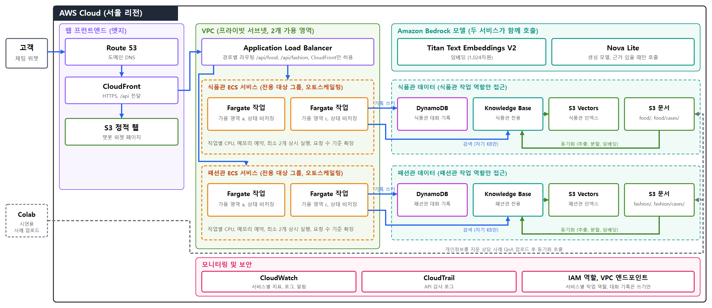

# CloudArchitecture: 서비스별 분리 RAG 고객센터 챗봇

클라우드 아키텍처 과제 프로젝트. 가상 쇼핑몰의 식품관과 패션관 고객센터 챗봇을 서비스별로 분리해 운영한다. 한 서비스에 문의가 몰려도 다른 서비스는 영향을 받지 않고, 각 챗봇은 자기 서비스의 규정만 근거로 답한다.



## 구조

```
app/                FastAPI 테스트 API (같은 이미지를 food, fashion 서비스에 배포)
Dockerfile          API 이미지
buildspec.yml       CodeBuild 이미지 빌드 설정
infra/stack.yaml    CloudFormation 스택 (VPC, ALB, ECS Fargate, IAM, S3, DynamoDB, CodeBuild)
notebooks/          Colab 배포 노트북
docs/               구성도
```

## 배포 (Colab)

1. [notebooks/deploy.ipynb를 Colab으로 연다](https://colab.research.google.com/github/ChangSik88/CloudArchitecture/blob/main/notebooks/deploy.ipynb).
2. Colab Secrets에 `AWS_ACCESS_KEY_ID`, `AWS_SECRET_ACCESS_KEY`를 넣는다.
3. 셀을 위에서부터 실행한다. 스택 생성(작업 0개) → CodeBuild 이미지 빌드 → 작업 2개로 확장 → 확인 테스트 순서다.
4. 끝나면 마지막 정리 셀로 스택을 지운다. ALB, 인터페이스 엔드포인트, Fargate 작업은 켜 둔 시간만큼 과금된다.

## API

| 경로 | 설명 |
|---|---|
| `GET /api/{food\|fashion}/health` | 상태 검사 |
| `GET /api/{food\|fashion}/info` | 응답한 작업의 가용 영역과 작업 ID |
| `POST /api/{food\|fashion}/log` | 자기 서비스 대화 기록 테이블에 쓰기 (`{"message": "..."}`) |

## 로컬 실행

```bash
pip install -r app/requirements.txt
SERVICE_NAME=food uvicorn app.main:app --port 8000
curl localhost:8000/api/food/health
```
